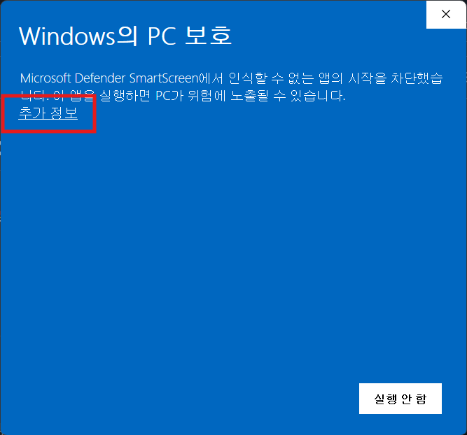
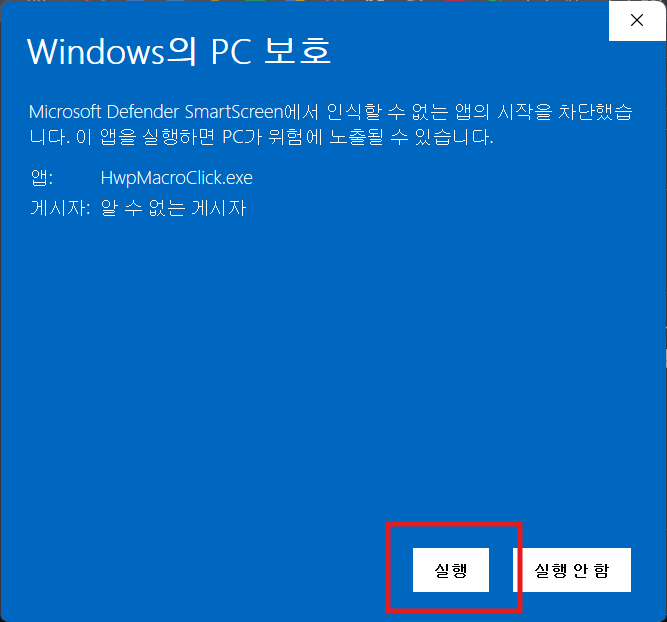

# 한/글 매크로 딸깍 (Hwp Macro Click)

한/글(HWP) 문서의 반복 편집 작업을 버튼 한 번으로 일괄 처리하는 Windows 프로그램입니다.
화면 좌표를 클릭하는 방식이 아니라 한/글의 공식 COM 개체로 직접 제어하므로 안정적으로 동작합니다.
수업 교재를 만드는 선생님·강사분들의 편집 시간을 줄이는 것이 목적입니다.

이 저장소는 **프로그램 배포 전용**입니다.

## 다운로드

**[HwpMacroClick.exe 다운로드 (최신 버전)](https://github.com/skwonnyg/hwp-macro-click-releases/releases/latest/download/HwpMacroClick.exe)**

버전별 파일과 변경 내용은 [Releases](https://github.com/skwonnyg/hwp-macro-click-releases/releases) 페이지에서 볼 수 있습니다.
설치는 필요 없고, 내려받은 파일을 그대로 실행하면 됩니다.

> Releases 페이지에 보이는 `Source code (zip)`, `Source code (tar.gz)` 는 GitHub 가 자동으로 붙이는 항목이며
> 프로그램과 무관합니다. 받을 필요 없이 `HwpMacroClick.exe` 만 받으세요.

## 제공하는 작업

| 작업 | 설명 |
| --- | --- |
| 빠른 정답 만들기 | 미주 번호부터 첫 문단(또는 첫 줄)을 모아 문서 맨 끝에 출력. 시작 방법(미주 첫 문단/미주번호)과 한 문단/한 줄을 선택 |
| 문제 간격 균등배분 | 미주(문제) 사이의 빈 문단 간격을 같은 단(또는 쪽) 안에서 균등하게 조정 |
| 수식 속성 일괄수정 | 문서 안 모든 수식(표 셀 안 포함)의 글자 크기와 좌우 바깥 여백을 지정한 값으로 통일 |

## 사용 방법

1. 작업할 문서를 한/글에서 열어 둡니다.
2. `HwpMacroClick.exe` 를 실행합니다.
3. **적용 대상**(현재 문서 / 현재창 모든탭 / 모든 창)을 고르고, 원하는 작업의 옵션을 정한 뒤 **실행**을 누릅니다.
   옵션은 작업별로 저장되어 다음 실행 때 복원됩니다.
4. 결과가 마음에 들지 않으면 **마지막 작업 되돌리기**를 누릅니다.

## 처음 실행할 때 나오는 경고 (Windows SmartScreen)

코드 서명이 없는 프로그램이라, 처음 실행하면 아래와 같은 "Windows의 PC 보호" 창이 나올 수 있습니다.
악성 프로그램이라는 뜻이 아니라 "아직 널리 알려지지 않은 앱"이라는 일반적인 경고입니다.
이 저장소의 릴리스에서 받은 파일이라면 아래 순서로 실행하세요.

**1. 왼쪽 위의 `추가 정보` 를 누릅니다.**

**2. 앱 이름이 `HwpMacroClick.exe` 인지 확인하고 `실행` 을 누릅니다.**

한 번 실행한 파일은 보통 다음부터 이 경고가 다시 나오지 않습니다.
다만 새 버전을 내려받으면 다른 파일이므로 경고가 다시 나올 수 있으며, 그때도 같은 방법으로 실행하면 됩니다.

## 알아두세요

- **요구 사항:** Windows, 한컴 한/글 (2024 에서 확인). 이미 열려 있는 한/글에 연결하며, 한/글을 종료하거나 문서를 닫지 않습니다.
- **자동 백업:** 작업을 실행하기 전에 문서를 임시 폴더에 자동으로 백업합니다.
- **되돌리기 주의:** 되돌리기는 문서를 통째로 이전 상태로 교체합니다. 실행 후 직접 편집한 내용도 함께 사라집니다.
- **파일 확인:** 각 릴리스 설명에 `HwpMacroClick.exe` 의 SHA-256 값이 적혀 있습니다. PowerShell 에서
  `Get-FileHash .\HwpMacroClick.exe -Algorithm SHA256` 로 계산해 비교할 수 있습니다.
- **업데이트:** 새 버전은 이 저장소의 Releases 에 올라옵니다. v0.2.1 부터는 프로그램을 시작할 때 최신 버전인지 확인하고,
  v0.3.0 부터는 새 버전이 있으면 `지금 업데이트` 로 내려받아 교체한 뒤 자동으로 다시 실행합니다(SHA-256 검증).
  프로그램 폴더에 파일을 쓸 수 없으면 다운로드 페이지를 열지 물어봅니다. v0.2.x 에서 v0.3.0 으로는 직접 교체해야 합니다.
- **인터넷 연결:** 시작할 때 최신 버전을 확인하므로 인터넷에 연결되어 있어야 프로그램이 실행됩니다(v0.2.1 이상).

## 오류보고 & 건의사항
- 오류보고 또는 건의사항은 skwonnyg@gmail.com 로 보내주세요.
- 오류보고를 할 때는 한/글 버전을 명시해주세요. 스크린샷을 첨부해주시면 문제를 파악하기가 쉬워집니다. 가능하면 오류가 났던 hwp 문서 파일도 보내주시면 좋습니다. 오류 발생시 정보가 많을수록 오류 수정이 빨라집니다.
- 필요한 기능 추가 등 건의사항도 언제든지 환영합니다.
